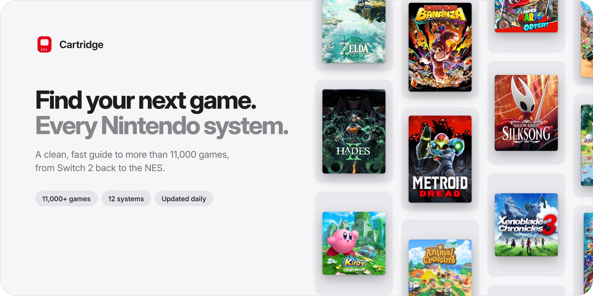
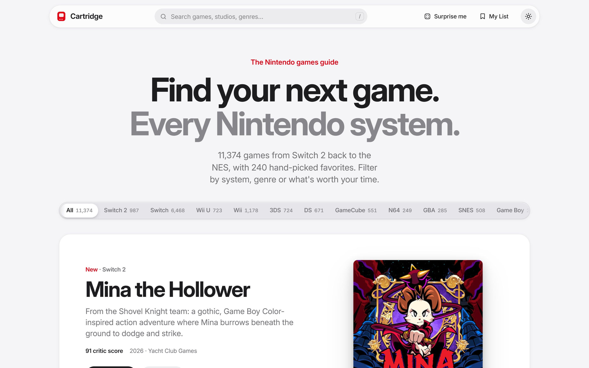
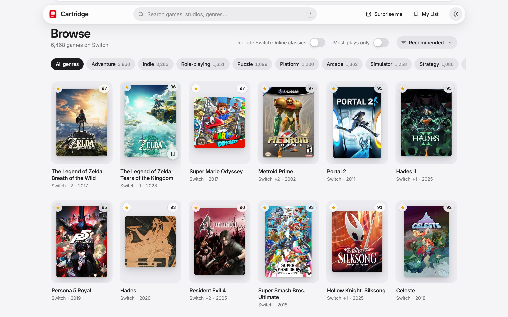
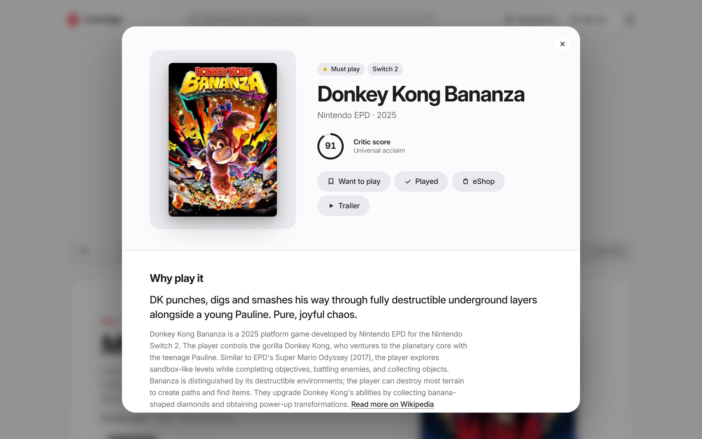
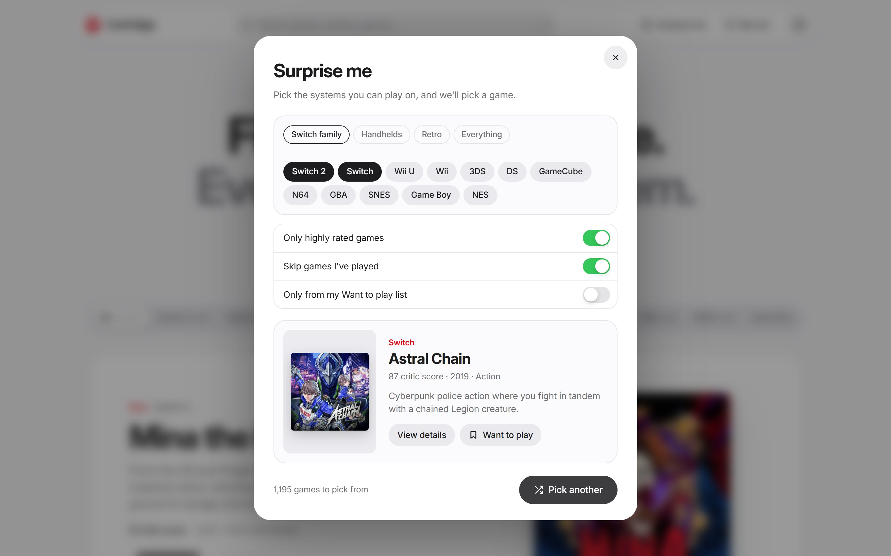
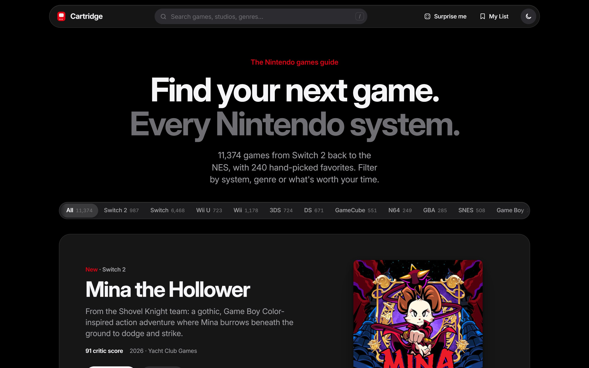
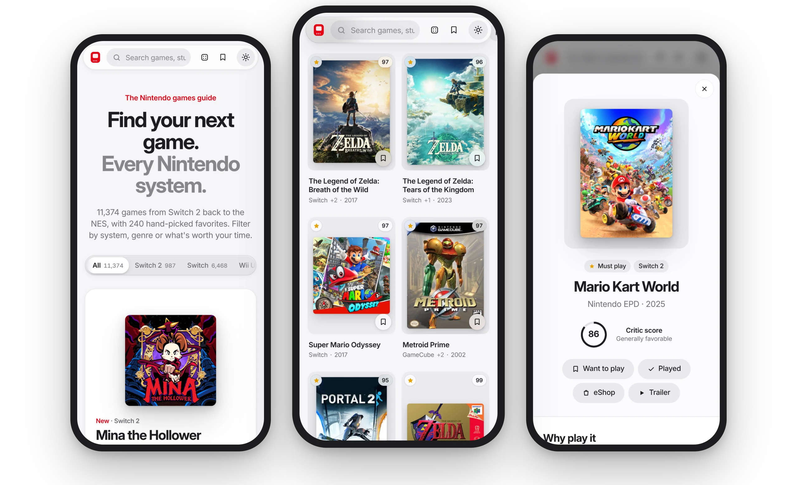

<a href="https://1akeno.github.io/cartridge/">
  <picture>
    <source media="(prefers-color-scheme: dark)" srcset="docs/images/banner-dark.webp">
    
  </picture>
</a>

 
 

**A clean, fast guide to more than 11,000 Nintendo games, from Switch 2 back to the NES.**

    

[**Visit the site**](https://1akeno.github.io/cartridge/) · [Features](#features) · [Screenshots](#a-closer-look) · [Credits](#credits)

 

<picture>
  <source media="(prefers-color-scheme: dark)" srcset="docs/images/home-dark.jpg">
  
</picture>

## About

Cartridge helps you decide what to play next on Nintendo hardware. It pairs a hand-picked selection of essential titles with a library of more than 11,000 games, so you can see at a glance what's worth your time on the system you own, whether that's a Switch 2 or a Game Boy.

## Features

<table>
  <tr>
    <td width="50%" valign="top">
      <h3>Every Nintendo system</h3>
      Switch 2, Switch, Wii U, Wii, 3DS, DS, GameCube, N64, Game Boy Advance, SNES, Game Boy and NES. Switch 2 owners can include backward-compatible Switch games; Switch owners can include Nintendo Switch Online classics.
    </td>
    <td width="50%" valign="top">
      <h3>The good stuff first</h3>
      Each system opens with a showcase of its best recent releases. Must-play games are marked throughout, and results sort by recommendation, critic score, release date or title.
    </td>
  </tr>
  <tr>
    <td valign="top">
      <h3>Instant search</h3>
      Search by title, studio, genre or year across the entire library. Accents and punctuation are ignored, so "pokemon" finds "Pokémon". Press <kbd>/</kbd> to start typing.
    </td>
    <td valign="top">
      <h3>Rich game pages</h3>
      Box art, a short description, developer, release date, critic score, player rating, play modes, similar games, and links to the Nintendo eShop and trailers.
    </td>
  </tr>
  <tr>
    <td valign="top">
      <h3>My List</h3>
      Save games you want to play and mark the ones you've finished. Your list stays in your browser, with no account needed.
    </td>
    <td valign="top">
      <h3>Surprise me</h3>
      Can't decide? Pick any mix of systems and get a highly rated recommendation. It can skip what you've played or choose from your Want to play list.
    </td>
  </tr>
  <tr>
    <td valign="top">
      <h3>Always up to date</h3>
      The library refreshes automatically every day, so new releases and updated scores appear on their own.
    </td>
    <td valign="top">
      <h3>Shareable everything</h3>
      Every filter, search and game page has its own link. Light and dark mode, built for phones, tablets and desktops.
    </td>
  </tr>
</table>

## A closer look

<table>
  <tr>
    <td width="50%" align="center">
      <picture>
        <source media="(prefers-color-scheme: dark)" srcset="docs/images/browse-dark.jpg">
        
      </picture>
       <b>Browse</b> by system and genre
    </td>
    <td width="50%" align="center">
      <picture>
        <source media="(prefers-color-scheme: dark)" srcset="docs/images/game-dark.jpg">
        
      </picture>
       <b>Game pages</b> with scores, details and similar games
    </td>
  </tr>
  <tr>
    <td width="50%" align="center">
      <picture>
        <source media="(prefers-color-scheme: dark)" srcset="docs/images/surprise-dark.jpg">
        
      </picture>
       <b>Surprise me</b> picks from the systems you own
    </td>
    <td width="50%" align="center">
      <picture>
        <source media="(prefers-color-scheme: dark)" srcset="docs/images/home-light.jpg">
        
      </picture>
       <b>Light and dark</b> mode, following your system
    </td>
  </tr>
</table>

### On your phone

<picture>
  <source media="(prefers-color-scheme: dark)" srcset="docs/images/phones-dark.webp">
  
</picture>

## Credits

- Game data, box art and descriptions for the full library from [IGDB](https://www.igdb.com).
- Cover art and summaries for hand-picked games from [Wikipedia](https://en.wikipedia.org).
- Hand-picked selections, must-play picks and blurbs are editorial. Their critic scores are approximate.

 

  
   
  Cartridge is an independent fan project and is not affiliated with, endorsed by or sponsored by Nintendo. All game titles, artwork and trademarks belong to their respective owners.

